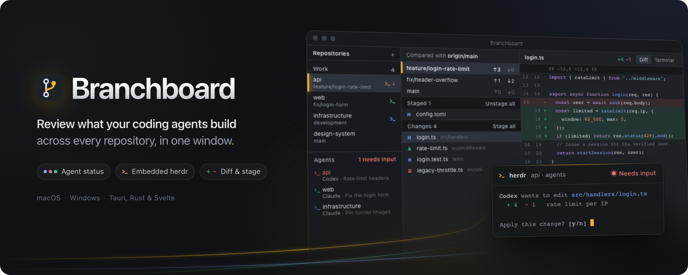
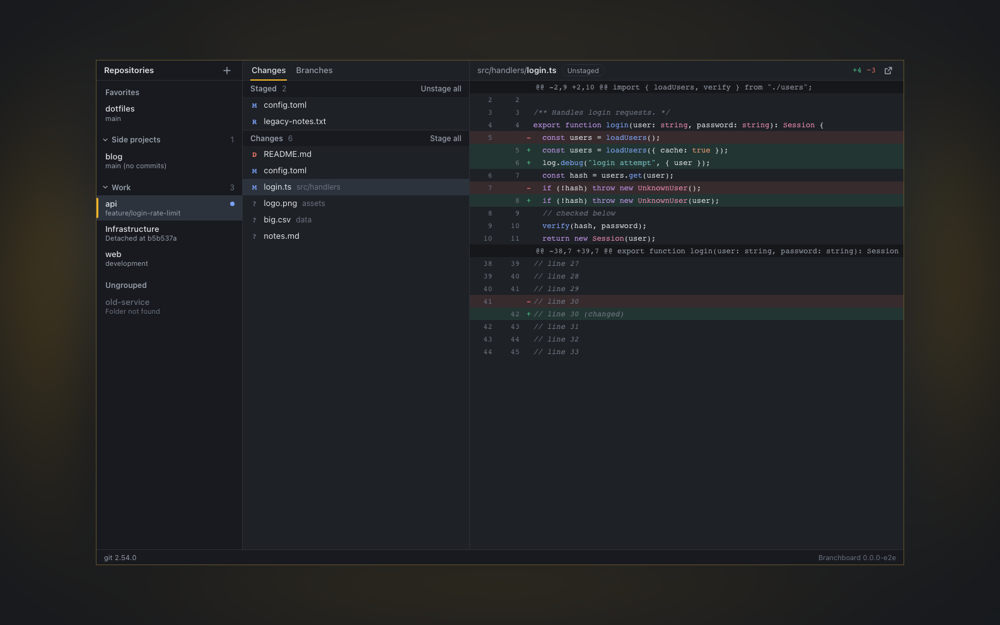

# Branchboard



**Review what your coding agents build — across every repository, in one window.**

Branchboard is a lean desktop app for macOS and Windows that sits between your coding agents
and your Git history. See at a glance which agents are working, blocked, or done in each
repository, step into their terminal, and review the diffs and branches they leave behind.

Agents run in [herdr](https://herdr.dev), which Branchboard embeds and steers. Branchboard
never runs agents itself, and without herdr it is a fast multi-repository Git GUI.
Built with Tauri 2, Rust, Svelte 5, and TypeScript, using your installed Git CLI.

## Features

- **Keep an eye on your agents.** See every agent across all herdr spaces with its state —
  working, blocked, done, or idle — next to the repository it works in. Click an agent to
  jump straight to it.
- **Agents and review in one window.** The herdr terminal runs embedded beside the diff.
  Switch between diff and terminal in the pane header; the terminal follows the selected
  repository, and navigating inside herdr selects the matching repository.
- **Your repositories, organized.** Add existing repositories through a folder picker or drag
  and drop, arrange them in groups, pin favorites, and jump between them with the quick switcher.
- **Review and stage.** Inspect syntax-highlighted unified diffs, stage or unstage individual
  files or a selection, and discard unstaged changes with confirmation. Untracked files are
  moved to the trash when discarded.
- **Know where branches stand.** View ahead/behind counts against a configurable comparison
  branch, inspect commits, and switch branches. Fetch manually or in the background.
- **Stay on the keyboard.** Use the command palette and shortcuts to navigate, fetch, or open
  a repository or changed file in VS Code.
- **Light and dark themes.** The interface follows your system appearance.



## Getting started

Branchboard is in active development. Installers are distributed through
[GitHub Releases](https://github.com/schaefer-dev/branchboard/releases), or you can build from source.

- **macOS:** choose the `aarch64` DMG for Apple Silicon or the `x64` DMG for Intel.
- **Windows x64:** use the `-setup.exe` installer. It installs for the current user and
  does not require administrator rights. If WebView2 is missing, the installer downloads
  it; this requires internet access.

Git 2.41 or newer must be available on `PATH`. Install herdr separately for agent features.
Builds are unsigned and macOS builds are not notarized, so Gatekeeper or SmartScreen may
show a warning. Code signing and automatic updates are not currently configured.

### Prerequisites

- Git 2.41 or newer, available on `PATH`.
- Node.js 24 or newer and pnpm; use the version pinned in `package.json`.
- Rust via [rustup](https://rustup.rs). The toolchain and components are pinned in
  `rust-toolchain.toml`.
- **macOS:** Xcode command line tools (`xcode-select --install`).
- **Windows:** MSVC C++ build tools, the Windows SDK, and the WebView2 runtime.
- **Optional:** [herdr](https://herdr.dev) for the agent features (tested with 0.9.3).
- **Optional:** VS Code for the editor integration.

### Run locally

```sh
git clone https://github.com/schaefer-dev/branchboard.git
cd branchboard
pnpm install --frozen-lockfile
pnpm app:dev
```

To create a release build and platform installers:

```sh
pnpm app:build
```

Build artifacts are written under `target/release/`; installers are under
`target/release/bundle/`. Code signing and automatic updates are not currently configured.
When building with an explicit `--target`, artifacts are under
`target/<target>/release/` instead. Windows builds produce a per-user NSIS EXE installer.

### First steps

1. Add an existing repository using the **+** button or drag its folder into the window.
2. Select a file in **Changes** to review its diff. Double-click or press `Space` to stage or
   unstage it; use the context menu for more actions.
3. Open **Branches** to compare and switch branches. In the branch options, use
   **Compare branches with…** to set your mainline, such as `origin/main`.
4. With herdr running, press `⌘ Shift T` to show the terminal next to your changes. A
   repository without a herdr workspace offers **Create workspace**.

The default comparison branch is `origin/development`, falling back to `origin/main`, then
`origin/master` if the preceding branches do not exist. Background fetching defaults to every
10 minutes for the active repository; change the interval or turn it off in the branch options.

### Keyboard shortcuts

Use `⌘` on macOS and `Ctrl` on Windows.

| Action            | macOS       | Windows        |
| ----------------- | ----------- | -------------- |
| Switch repository | `⌘ P`       | `Ctrl P`       |
| Command palette   | `⌘ K`       | `Ctrl K`       |
| Add repositories  | `⌘ O`       | `Ctrl O`       |
| Show changes      | `⌘ 1`       | `Ctrl 1`       |
| Show branches     | `⌘ 2`       | `Ctrl 2`       |
| Show terminal     | `⌘ Shift T` | `Ctrl Shift T` |
| Fetch             | `⌘ Shift F` | `Ctrl Shift F` |
| Open in VS Code   | `⌘ Shift E` | `Ctrl Shift E` |

## Current scope

Branchboard focuses on repository navigation, review, file-level staging, and branch switching.
It does not currently provide committing, push/pull, hunk- or line-level staging, side-by-side
diffs, a history graph, or conflict resolution.

## Development

| Task                               | Command                                                 |
| ---------------------------------- | ------------------------------------------------------- |
| Rust tests                         | `cargo test --workspace`                                |
| Rust lint                          | `cargo clippy --workspace --all-targets -- -D warnings` |
| Rust format check                  | `cargo fmt --all --check`                               |
| Regenerate TS bindings             | `pnpm bindings`                                         |
| Frontend lint and formatting check | `pnpm lint`                                             |
| Frontend type check                | `pnpm check`                                            |
| Frontend tests                     | `pnpm test`                                             |
| UI end-to-end tests                | `pnpm e2e`                                              |
| Capture UI screenshots             | `pnpm e2e screenshots`                                  |

For end-to-end tests, install the browser runtimes once with
`pnpm exec playwright install chromium webkit`. Screenshot tests write review artifacts to
`e2e-results/screenshots/`. CI checks and builds the app on macOS and Windows.

Set `BRANCHBOARD_WORKSPACE_FILE` to an absolute path to a separate JSON file when developing
or testing with a different repository list. This keeps that workspace separate from your
usual Branchboard configuration.

### Creating a release

Keep the workspace version in `Cargo.toml` and the version in `package.json` equal,
and update `Cargo.lock` when changing the workspace version. Tauri inherits the Cargo
version. Commit and push the release changes before tagging that commit:

```sh
git tag -a v0.1.0 -m "Branchboard 0.1.0"
git push origin v0.1.0
```

The Release workflow runs the existing CI checks, then builds Apple Silicon and Intel
macOS bundles and the Windows x64 installer. The Windows job verifies installation,
reinstallation, the installed app, and uninstallation as a temporary standard user.
All bundles are uploaded to one **draft** release. A failed build or installer check
can leave a partial draft; publish only after the workflow succeeds and all platform
installers are present. Open the draft, review its notes and assets, then publish it.

For a transient failure, select **Re-run failed jobs** in Actions, or run:

```sh
gh run rerun <run-id> --failed
```

Reruns use the original tagged commit and upload to the same draft. If a code fix is
needed before publication, commit and push the fix, ensure the old workflow has stopped,
then delete the incomplete draft and recreate the tag:

```sh
gh release delete v0.1.0 --yes
git push origin :refs/tags/v0.1.0
git tag -d v0.1.0
git tag -a v0.1.0 -m "Branchboard 0.1.0"
git push origin v0.1.0
```

Only do this while the release is unpublished. After publication, use a new patch
version such as `0.1.1`; the workflow refuses to modify an already published release.

### Project layout

```text
crates/git-core/   Git domain types and CLI adapter (no Tauri dependency)
crates/workspace/  Repository registry, persistence, monitoring, editor integration
crates/highlight/  Syntax highlighting for diffs
crates/herdr/      herdr socket API client: agent state and workspaces
crates/pty/        Pseudo terminal for the embedded herdr client
src-tauri/        Tauri shell: commands, state, events
ui/src/           Svelte 5 frontend
  lib/api/        Typed command wrappers and generated bindings
  lib/state/      Application state
  lib/ui/         Design tokens and shared components
  features/       Repositories, changes, branches, diffs, agents, terminal, and app shell
ui/e2e/           Playwright specs, fake backend, and recorded fixtures
```
